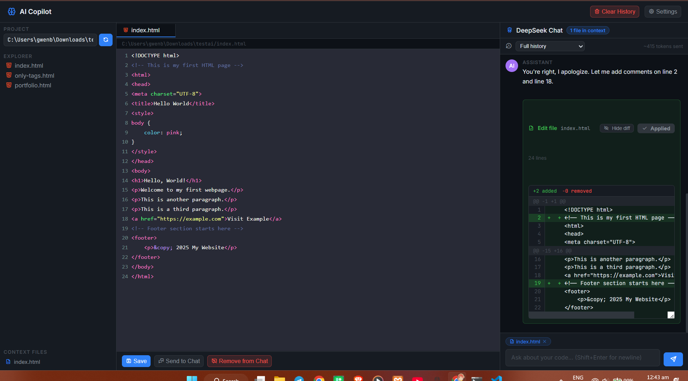

# Local Copilot

A local Copilot-style web IDE that lets you browse, edit, and chat about your project files using the DeepSeek API.



## Run locally

```bash
npm install
npm start
```

Open `http://127.0.0.1:3000`, enter an absolute project path, and add your
DeepSeek API key in Settings. The server binds to your computer only by
default; set `HOST` explicitly if you intentionally need network access.
On Windows, you can also start it with `run.bat` after installing dependencies.

## Safety and limits

- Project paths must be absolute and file operations cannot leave the selected root.
- Hidden folders, dependency folders, build output, and symbolic links are omitted from the explorer.
- Individual files are limited to 2 MB and the explorer is limited to 10,000 entries.
- AI-created files can be removed again with **Undo Apply**.

Run the regression checks with `npm test`.

## Features

- 📁 **File Explorer** — browse your local project folder
- 📝 **Code Editor** — open and edit files with syntax-aware textarea
- 💬 **AI Chat** — chat with DeepSeek about your code
- 🧠 **File Context** — attach open files to the chat context
- ✅ **One-click Apply** — AI-suggested edits applied directly to disk
- 🆕 **File Creation** — AI can create new files in your project
