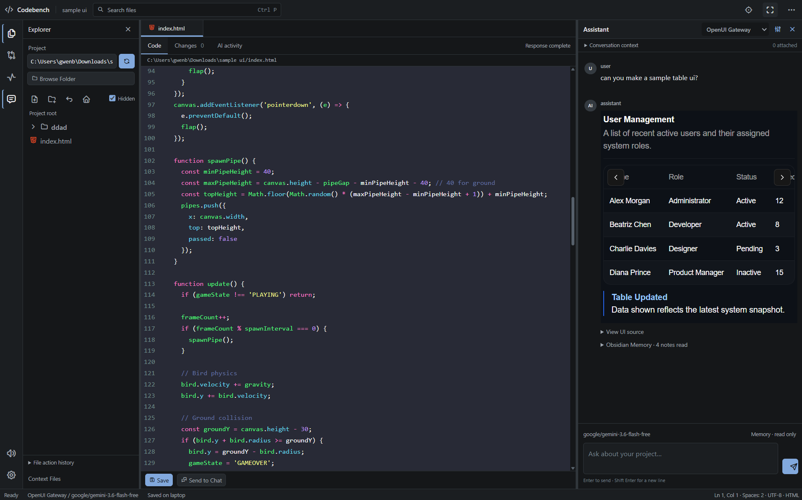

# Draftdrion

**Draft. Review. Build.**

A local coding workspace by **Balajedrion**.

Open a folder, work on your code, and review AI changes before applying them. Runs on your laptop and connects to the AI provider you choose.

[Quick start](#quick-start) · [Features](#features) · [Providers](#providers) · [Full guide](docs/guide.md)



_Screenshot captured before the Draftdrion rename._

## Features

| | What you can do |
| --- | --- |
| **Code editor** | Syntax highlighting, Find & Replace, Quick Open, and per-file undo. |
| **File explorer** | Create files and folders, rename or move items, and undo file actions—including deletes. |
| **AI change review** | Review inline or side by side, apply selected files, and undo each apply. |
| **Assistant** | Attach files, follow streamed replies, pause with Stop, and retry. OpenUI replies can render cards and tables. |
| **Agent tools** | Explore a repository, search/read the web, inspect public pages, and run approved commands or tests. |
| **Activity history** | Timestamped steps grouped by request, with command approval and expandable output. |
| **Obsidian Memory** | Optional access for each provider: Off, Read only, or scoped Read & write through MCP. |
| **Your workspace** | Resizable panels, focus mode, fullscreen, subtle scrollbars, and optional feedback sounds. |

Settings, conversations, drafts, and Undo history are saved as files on your laptop. The footer shows **Saved on laptop** when saving is complete.

## Windows desktop app

Draftdrion also runs in its own desktop window, with the same editor, providers, local settings, and conversations. The installed app includes its runtime; Node.js is only needed to run or build from source.

After `npm install`, launch it with:

```bash
npm run desktop
```

Build a Windows x64 installer with `npm run desktop:build`. The installer is written to `dist/`; generated builds are excluded from Git. See the [desktop guide](docs/guide.md#windows-desktop-app) for private configuration and installation details.

## Quick start

Requires **Node.js 22.12+** and **npm**.

```bash
git clone https://github.com/gwenz2/local-copilot.git
cd local-copilot
npm install
npm start
```

Open the local URL printed in your terminal—by default, [http://127.0.0.1:3000](http://127.0.0.1:3000).

1. Select **Browse Folder** and open your project.
2. Open **Settings → AI & context**, choose a provider and model, then save your settings.
3. Open a file and select **Send to Chat** to attach it to your question.
4. Review suggested edits in **Changes**, then select the files you want to apply.

On Windows, you can also launch with `run.bat` after installing dependencies.

## Providers

**OpenUI Gateway · DeepSeek · OpenAI · Claude · Gemini · Custom OpenAI-compatible APIs**

Each provider remembers its own model and memory settings. API availability, quotas, and billing depend on the service you choose. Local compatible servers can run without an API key.

<details>
<summary><strong>Set up OpenUI Gateway</strong></summary>

Open **Settings → Connections**, enter your OpenUI backend key, and select **Test OpenUI**. Web and desktop share the saved connection on this laptop.

For an initial source setup, an ignored `.env` can also seed the connection once:

```env
THESYS_API_KEY=your_backend_key
PORT=3001
```

Choose **OpenUI Gateway** in AI & context. After the first import, manage its shared key in Connections; later `.env` edits do not replace it. Its key stays on the server. Generated UI is specific to OpenUI; other providers use the standard chat display.

</details>

## Agent tools

Open **Settings → Agent & tools** to enable or disable repository exploration, web search, page reading, browser inspection, and terminal access. Repository exploration and no-key public web research start enabled; browser inspection starts off. A model must support tool calling.

Terminal commands ask for approval in **AI activity**. Choose **Automatically approve all commands** to run without a list or command prompts, including critical commands. The separate listed-command mode still asks for critical or unrecognized commands. All mode grants normal-account command execution; use it only for projects you trust. Configure a test command, ask the assistant to run it, review proposed fixes in **Changes**, apply them, then ask it to rerun tests. Stop cancels pending approvals and running processes.

AI activity keeps the last 20 requests per project with timestamps on your laptop. Detailed command output and screenshots are session-only. Public browser inspection uses a separate temporary profile and supports one public IPv4 site per call; it is not a signed-in browser or a full website-testing agent.

## Local data & privacy

- App data is stored in `%LOCALAPPDATA%\GwensCodebench` on Windows, independently of your browser session. The existing `GwensCodebench` folder name is retained so saved data keeps working.
- Attached code, tool-retrieved project/web content, command results, and retrieved memory are sent to the selected AI provider. Running locally does not make cloud AI requests offline.
- Provider credentials are stored separately on the server. Local credential files are plain text; keep them private, along with `.env`, `connections.json`, and the app data folder. Terminal commands use your account permissions and can change files; approval is not an OS sandbox.
- Obsidian access is optional. Writes require an enabled, mapped project; shared instruction and preference notes stay read only.

See the [full guide](docs/guide.md) for storage, recoverable deletes, MCP configuration, and access limits.

<details>
<summary><strong>Keyboard shortcuts</strong></summary>

| Shortcut | Action |
| --- | --- |
| `Ctrl+P` | Quick Open |
| `Ctrl+S` | Save file |
| `Ctrl+F` / `Ctrl+H` | Find / Replace |
| `Ctrl+B` | Toggle Explorer |
| `Ctrl+Alt+B` | Toggle Assistant |
| `Ctrl+Shift+F` | Toggle editor focus mode |
| `F2` / `Delete` | Rename / delete a focused Explorer item |

</details>

## Development

```bash
npm run dev
npm test
```

Built with **Node.js, Express, vanilla JavaScript, and CodeMirror 5**.
