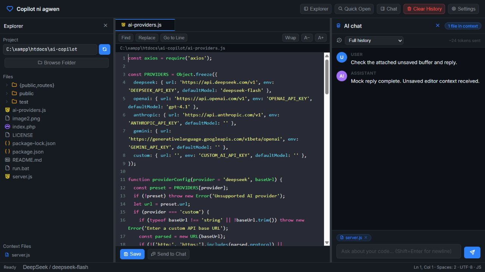

# Local Copilot

A local web editor for browsing project files, editing code, and chatting with an AI assistant.



## Get started

Requires Node.js and npm. Run these commands in the project folder:

```bash
npm install
npm start
```

Open [127.0.0.1:3000](http://127.0.0.1:3000/), then:

1. Click **Browse Folder** to open your project.
2. Open **Settings**, choose a provider, and enter its API key.
3. Click **Load models** or enter a text chat model ID, then **Save**.
4. Open a file and click **Send to Chat** to attach it before asking a question.

On Windows, you can also use `run.bat` after installing dependencies. Restart the server and refresh the page after backend updates.

## What it does

- Browse files and switch between projects with separate chat history and context.
- Edit code with syntax highlighting, Find/Replace, Go to Line, bracket matching, and per-file undo history.
- Collapse or resize either side panel. Layout settings are remembered, and hiding chat keeps an active AI request running.
- Attach files to chat, including current unsaved edits in open files.
- Preview AI changes with **Show diff**, write them with **Apply**, and revert them with **Undo Apply**.

## AI providers

Supports **DeepSeek, OpenAI, Claude, Gemini**, and **custom OpenAI-compatible APIs**. Change the provider, model, and output limit in Settings. Each provider keeps its own key and model settings.

Custom providers need an API base URL, such as `https://example.com/v1`. Local compatible servers can run without an API key.

The AI sees the files you attach, not your entire project folder. Attached code is sent to the selected provider. Saved API keys stay in your browser; API access and billing depend on your provider account.

## Shortcuts

| Shortcut | Action |
| --- | --- |
| `Ctrl+P` | Quick Open |
| `Ctrl+B` | Toggle Explorer |
| `Ctrl+Alt+B` | Toggle AI chat |
| `Ctrl+S` | Save file |
| `Ctrl+F` / `Ctrl+H` | Find / Replace |
| `Ctrl+G` | Go to Line |
| `Ctrl+/` | Toggle comment |

## Development

```bash
npm run dev
npm test
```

The server listens on `127.0.0.1` by default. Files are limited to 2 MB each, and the explorer lists up to 10,000 entries.
